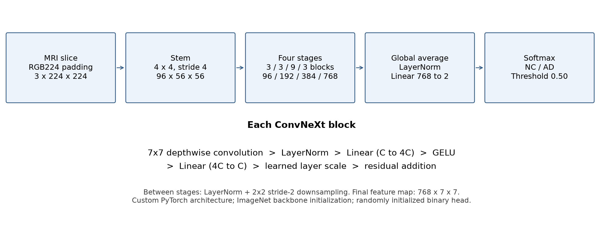
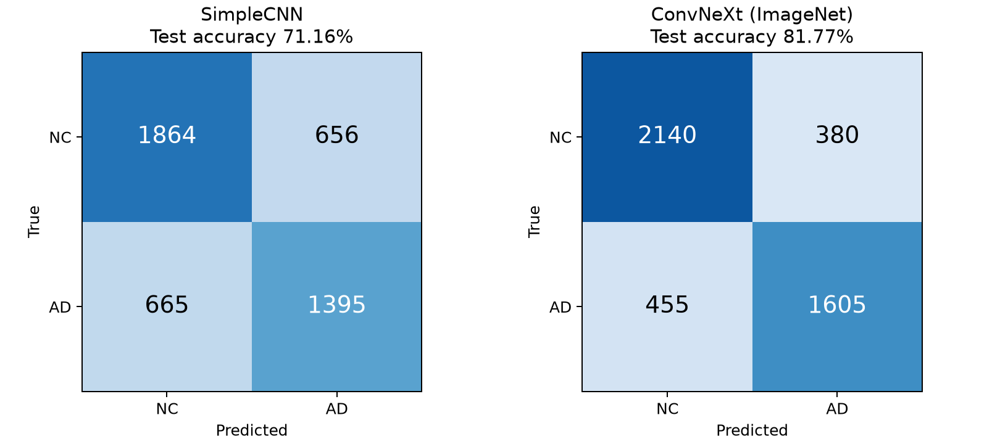
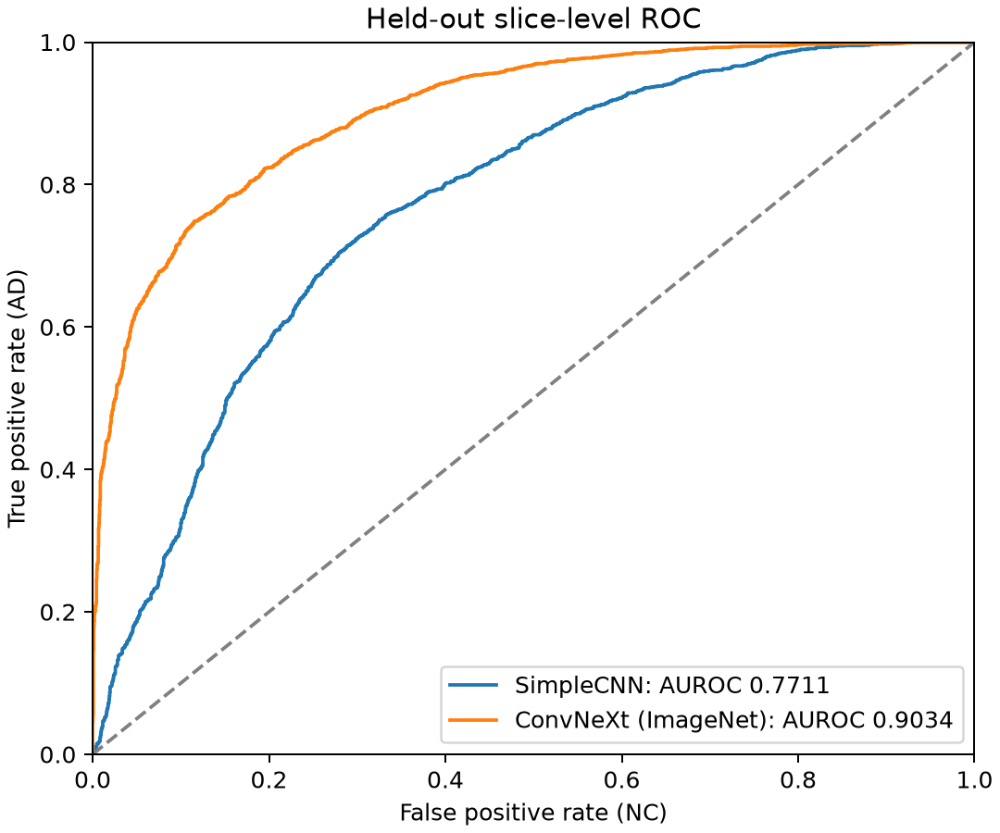
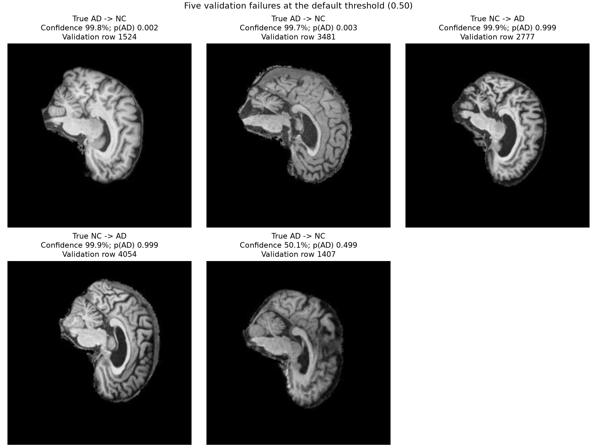
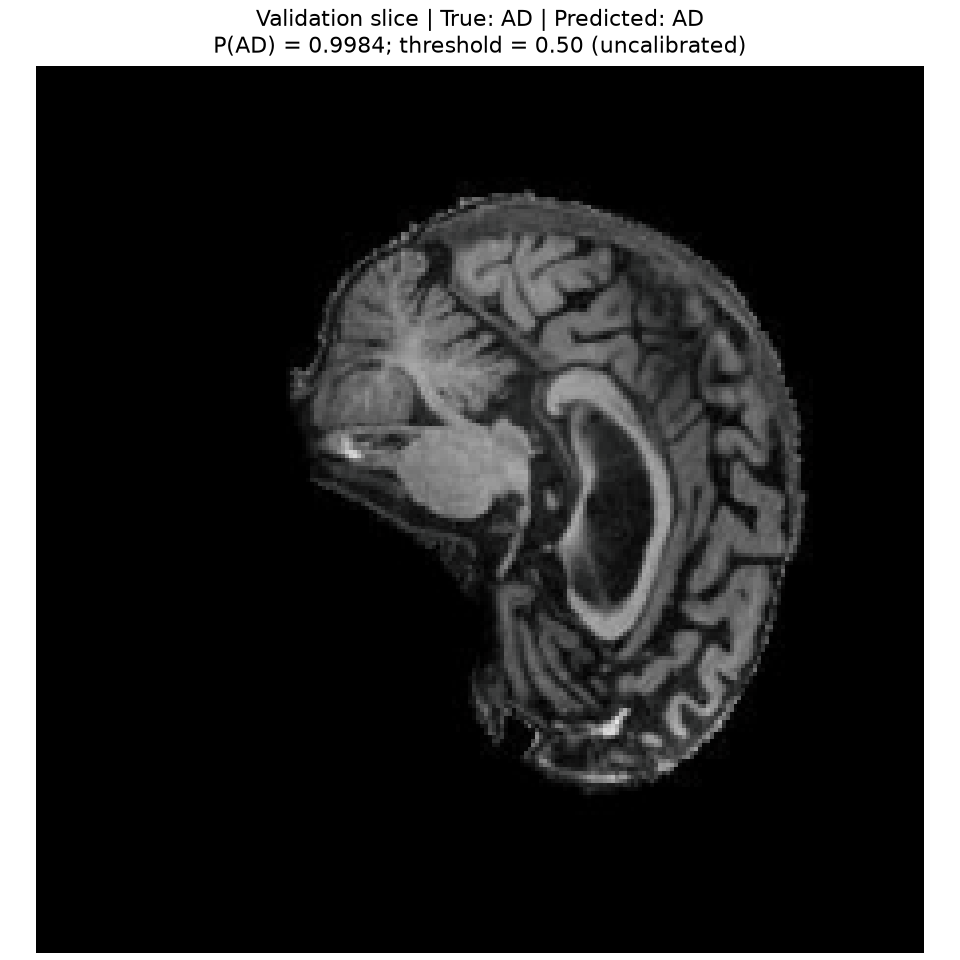
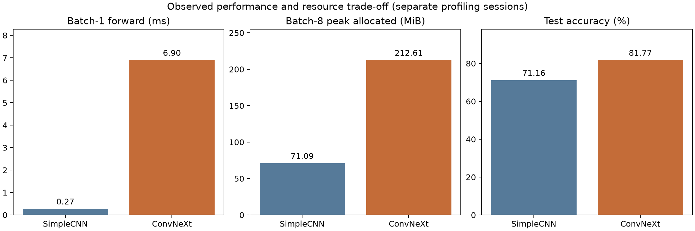

# Patient-disjoint ADNI slice classification with a custom ConvNeXt

COMP3710 - Hard difficulty | s4990492 | 27 October 2026

## Abstract

This project compares a custom ConvNeXt-Tiny with a compact CNN for Alzheimer's disease (AD) versus normal control (NC) classification of individual MRI slices. A data audit identified 216 patients shared by the supplied training and test directories. A fixed replacement split therefore groups all scans and slices from each patient together. Experiments examined augmentation, learning rate, stochastic depth, model width, scheduling and initialization. The final ImageNet-initialized custom ConvNeXt achieved **81.7686% accuracy** and **0.903406 AUROC** on 4,580 held-out slices, compared with **71.1572% accuracy** and **0.771076 AUROC** for the baseline. The improvement costs substantially more parameters and inference time. Validation confidence analysis also identified highly confident mistakes, supporting cautious use of confidence for research review rather than autonomous diagnosis. Results apply to the disclosed replacement split; they are not scores on the original folder partition.

## 1. User need and model principles

The intended user is a research reviewer comparing classification pipelines and inspecting uncertain or incorrect predictions. The prototype accepts one MRI JPEG slice and returns NC/AD probabilities, a binary decision and an input/output visualization. Acceptance criteria are patient-disjoint evaluation, the course's 80% full-test slice-accuracy target, per-class and ranking metrics, feasible execution on available hardware, and an explanation of errors and computational trade-offs. A confidence-based referral analysis is supplementary; it cannot replace full-set accuracy.

ConvNeXt modernizes a convolutional network using large depthwise kernels, channel mixing, normalization and residual blocks [1,2]. In this implementation, a 7x7 depthwise convolution learns spatial features separately per channel. LayerNorm stabilizes channel activations; linear expansion to four times the width, GELU and projection mix channels. A learned layer scale controls the residual update. Backpropagation and cross-entropy train features for the two labels. The four stages use depths [3,3,9,3] and widths [96,192,384,768], followed by spatial averaging, normalization and a binary head. The final RGB variant has 27,821,666 parameters. All model layers are defined in `modules.py` using PyTorch.

The SimpleCNN baseline uses three convolution/ReLU/max-pooling blocks with 16,32,64 channels, global average pooling and a two-class head: 23,426 parameters. It tests whether the larger model's predictive benefit justifies its resource cost. Both use NC=0 and AD=1.

## 2. Dataset exploration and evaluation protocol

The supplied ADNI collection contains 30,520 JPEG slices, 20 per scan, from 680 patients (221 AD, 459 NC). The metadata audit matched every image and found no conflicting patient labels. Original training and test folders contain 21,520 and 9,000 images respectively. They share 216 patients; 5,560 original test images belong to patients also present in training. Consequently, preserving those folders would not measure generalization to entirely unseen patients.

The project pools the directories and creates a fixed class-stratified patient split with seed 42. All visits, scans and slices for a patient stay in one partition; source images are not moved.

| Split | Patients | Scans | Slices | AD slices | NC slices |
|---|---:|---:|---:|---:|---:|
| Train | 475 | 1,068 | 21,360 | 10,500 | 10,860 |
| Validation | 101 | 229 | 4,580 | 2,300 | 2,280 |
| Test | 104 | 229 | 4,580 | 2,060 | 2,520 |

The manifest union exactly matches the source, with zero pairwise patient, scan or path overlap and no duplicate paths. All images decoded successfully; file-byte and decoded-grayscale hashing found no exact duplicate content. Near-duplicates are not ruled out by exact hashing. Multiple scans still give some patients greater weight in slice-level metrics.

At the 20 October check-off, the tutor recommended splitting validation from training. The implemented pooled patient split differs from using only the original training folder to derive validation. The original overlap motivated the replacement; no explicit tutor approval of that replacement is recorded. This difference is disclosed rather than treated as implied approval. Later teaching clarification established slice-level accuracy as the required metric. Patient aggregation is not used to meet the target.

### Preprocessing and labels

Original metadata labels AD=2 and NC=0 map to AD=1 and NC=0. Baseline and early scratch models use original-size grayscale tensors in [0,1], typically 240x256. The final model uses grayscale conversion followed by aspect-preserving bilinear resize with black padding to 224x224, replication into three channels, and normalization with mean [0.485,0.456,0.406] and standard deviation [0.229,0.224,0.225]. These normalization constants match the official weights [3], but the project's padding pipeline differs from the official resize-and-center-crop transform. Replication adds no new imaging information.

Training-only augmentation applies rotation up to 5 degrees and translations up to 3%, using bilinear interpolation and zero fill. Validation and test use deterministic preprocessing. The supplied JPEG data are used without reconstructing scans or altering labels. Image inspection identified variation in appearance but did not establish a train/test preprocessing defect; exact upstream slice-selection details were unavailable.

### Selection and held-out testing

Checkpoints are selected by minimum validation loss, not the highest accuracy seen in a log. Final model and operating rules were fixed before test inference. The primary decision threshold is 0.50; a validation-selected threshold of 0.21 was specified as supplementary and both are reported regardless of test performance. Test results are not used for further training, model selection or threshold tuning. Manifests and checkpoint SHA256 values identify the evaluated artifacts; local path rewriting changes manifest hashes without intentionally changing split membership.

## 3. Experiments and model selection

All experiments use the same patient memberships, batch size 8 and seed 42. The table reports the checkpoint selected by minimum validation loss within each run. Rounded log accuracies are distinguished from full evaluation outputs. Native-image runs and RGB224 runs differ in preprocessing and are not pure initialization comparisons.

| Experiment | Epoch budget | Selected epoch | Val loss | Val accuracy |
|---|---:|---:|---:|---:|
| SimpleCNN, remote scratch, Adam 1e-3 | 20 | 9 | 0.525835 | 73.78% |
| ConvNeXt, remote scratch, AdamW 1e-4 | 20 | 1 | 0.673260 | 58.54% |
| ConvNeXt + affine, remote 1e-4 | 20 | 12 | 0.624327 | 68.1% |
| ConvNeXt + affine, remote 3e-5 | 20 | 6 | 0.576705 | 67.01% |
| Local native + affine, 3e-5 | 20 | 6 | 0.561936 | 70.09% |
| Local native + stochastic depth | 20 | 6 | 0.563209 | 69.8% |
| Local native + cosine schedule | 20 | 6 | 0.562608 | 69.8% |
| Local compact + affine, 3e-5 | 20 | 6 | 0.566502 | 68.7% |
| RGB224 scratch, 3e-5 | 10 | 1 | 0.565854 | 70.8% |
| RGB224 ImageNet, 3e-5 | 10 | 1 | 0.685120 | 73.9% |
| RGB224 ImageNet, 3e-6 (final) | 5 | 3 | 0.642845 | 76.62% |

The unaugmented ConvNeXt rapidly fitted training data while validation loss increased. Affine augmentation and lower learning rates improved validation behavior. Stochastic depth, cosine scheduling and halving channel widths did not improve the selected local validation result. The smaller model reduced measured training memory but did not solve the generalization gap. This motivated an initialization comparison rather than simply extending training.

The matched RGB224 experiment keeps preprocessing, augmentation, optimizer, learning rate and ten-epoch budget fixed while changing initialization. ImageNet initialization raised selected validation accuracy from 70.8% to 73.9%, although its selected cross-entropy was worse. The pretrained run reached 79.8% accuracy at epoch 4, but that checkpoint was not selected by the predefined loss criterion. Thus 79.8% is a log observation, not the final model's reported performance.

A separate five-epoch fine-tuning run reduced the learning rate to 3e-6. Its epoch-3 checkpoint improved validation accuracy to 76.6157% and loss to 0.642845. Relative to the first five epochs of the earlier pretrained run, it improved the minimum-loss-selected result. The full ten-epoch budget is not identical. These are single-seed experiments and do not establish an expected gain over repeated seeds.

### Implementation and initialization checks

The final model uses official ImageNet weights [3,4] mapped into the custom architecture; it does not train a prebuilt torchvision model. Exactly 180 backbone tensors were mapped, the ImageNet 1,000-class head was discarded, and the binary head was randomly initialized. All layers were fine-tuned. The mapping records source, tensor shapes and weight hash. Synthetic reference checks verified forward parity and finite gradients; a separate custom-architecture check compared intermediate activations and gradients against a randomly initialized reference. Official-weight loading and both initialization smoke tests passed. Smoke results cover partial batches and are not performance estimates.

The final validation evaluator reproduced loss and accuracy exactly in the local environment. The remote baseline required an approximate reproduction check: local CPU and CUDA losses agreed within 5.13e-9 but differed from the historical loss by about 1.38e-5. Accuracy and confusion matrix matched. Before baseline test inference, the loss tolerance was changed from 1e-5 to 1e-4 while retaining exact confusion-matrix agreement. The original strict failure is preserved in the experiment record. The discrepancy's cause is unconfirmed; weights, preprocessing, thresholds and split were not changed.

## 4. Held-out test results

Both preselected models were evaluated on the same 4,580 test slices from 104 patients (2,520 NC and 2,060 AD), using the predefined primary threshold 0.50. No test-based model or threshold retuning was performed. The retrieved SimpleCNN checkpoint passed the explicitly approximate cross-environment validation gate; the original stricter check failure and loss difference are documented in Section 3 and the experiment record.

| Test metric | SimpleCNN baseline (epoch 9) | Custom ConvNeXt, ImageNet fine-tuned (epoch 3) |
|---|---:|---:|
| Accuracy | 71.1572% | **81.7686%** |
| Balanced accuracy | 70.8434% | **81.4166%** |
| Macro-F1 | 0.708516 | **0.815163** |
| AUROC (AD positive) | 0.771076 | **0.903406** |
| NC precision | 0.737050 | 0.824663 |
| NC recall | 0.739683 | 0.849206 |
| NC F1 | 0.738364 | 0.836755 |
| AD precision | 0.680156 | 0.808564 |
| AD recall | 0.677184 | 0.779126 |
| AD F1 | 0.678667 | 0.793572 |
| Cross-entropy loss | 0.569680 | 0.457084 |
| Incorrect slices | 1321 | 835 |

Baseline confusion matrix (rows=true, columns=predicted; NC, AD): `[[1864,656],[665,1395]]`. The main model correctly classified 486 more slices, increasing accuracy by 10.6114 percentage points. AD false negatives decreased from 665 to 455, and NC false positives from 656 to 380. These are observed differences on one patient-disjoint test split, not a statistical-significance claim.

This is a comparison of complete prediction pipelines, not an isolated architecture ablation: the main model uses ImageNet initialization and RGB224 normalization, while the baseline was trained from scratch on original-size grayscale inputs, with different training settings. The matched initialization experiments earlier in this report address initialization separately on validation data. The final accuracy difference cannot be attributed solely to the ConvNeXt architecture or solely to pretraining. No claim of clinical readiness follows from these results.

The baseline test artifacts are saved privately under `runs/baseline_20261022_211305_056381/final_baseline_evaluation/`. Its retrieved checkpoint SHA256 is `593339ff8dd1dc992c55db6412611531bd347d3b30c04f76bf395d4f99a94e93`. Local baseline timing and memory profiling are completed in the resource comparison below.

### Final test visualizations

`plot_final_results.py` renders these aggregate figures from saved predictions and metrics, checking matched test-row identities, confusion-matrix totals and reproduced AUROC. It does not run inference or select models.

The primary ConvNeXt correctly classified 3,745/4,580 slices and exceeded the numerical 80% target under this split. At the predefined supplementary threshold 0.21, accuracy was 79.9782%, balanced accuracy 80.5384%, macro-F1 0.799655, and AUROC remained 0.903406. Its confusion matrix was [[1889,631],[286,1774]]: AD recall increased to 86.1165%, while NC recall fell to 74.9603%. The unrounded supplementary accuracy is below 80%. This threshold illustrates a sensitivity/specificity trade-off; it is not substituted for the primary rule based on test outcomes.

## 5. Confidence, failure cases and practical use

For the final validation checkpoint, top-label expected calibration error over ten equal-width bins was 0.140214 and binary Brier score was 0.183350. No probability calibration was fitted. At the primary classification threshold, retaining only predictions with confidence at least 0.80 kept 3,725/4,580 slices (81.33% coverage), achieving 81.50% retained accuracy and referring 855 slices. At confidence 0.90, coverage fell to 70.96% and retained accuracy rose to 84.43%, but 506 retained errors remained. Higher selective accuracy is therefore obtained by reducing coverage, and does not imply the full-set target has been met.

Five validation failures were selected from distinct patients: two most-confident false negatives, two most-confident false positives, and one remaining error nearest the decision boundary. This purposeful selection illustrates failure types rather than their population frequencies.

| Validation row | True / predicted | P(AD) | Interpretation and response |
|---|---|---:|---|
| 1524 | AD / NC | 0.002124 | Extreme false negative; confidence referral alone would miss it |
| 3481 | AD / NC | 0.002849 | Another distinct patient with the same failure; threshold 0.21 would not correct it |
| 2777 | NC / AD | 0.999369 | Extreme false positive; high confidence is not reliable confirmation |
| 4054 | NC / AD | 0.999212 | Repeated false-positive pattern across patients; review remains necessary |
| 1407 | AD / NC | 0.499264 | Boundary-sensitive error; switching to 0.21 changes this decision |

The first four cases demonstrate confident errors that persist under both thresholds; the fifth shows an operating-point effect. Limited independent patient diversity, slice-level ambiguity and overfitting are possible contributors, supported by the training/validation gap, but these examples do not identify their individual causes. No diagnostic conclusion is drawn from anatomy alone. The following report figure shows the five selected validation cases. It contains model outputs and manifest row numbers, without patient IDs or file paths. Full selection metadata remain in the private run directory.

The verified prediction example uses validation row 0: true AD, predicted AD, P(AD)=0.998354 at threshold 0.50. It displays the actual normalized input after undoing normalization for viewing. It is a software input/output demonstration, not additional accuracy evidence. The following report figure shows the input and predicted output.

## 6. Resource costs and recommendation

Both models were profiled on the NVIDIA GeForce RTX 4050 Laptop GPU with PyTorch 2.11.0+cu128, float32, 10 warmup batches and 50 timed forward batches. Each keeps its own training-time preprocessing. The measurements were taken in separate sessions, so power/load and caching differences limit causal speed comparisons.

| Measurement | SimpleCNN | Custom ConvNeXt RGB |
|---|---:|---:|
| Parameters | 23,426 | 27,821,666 |
| Test accuracy, primary threshold | 71.1572% | 81.7686% |
| Batch-1 median forward | 0.2744 ms | 6.8982 ms |
| Batch-8 median forward per batch | 2.1767 ms | 24.3770 ms |
| Batch-8 amortized forward per slice | 0.2721 ms | 3.0471 ms |
| Batch-1 peak allocated GPU memory | 16.95 MiB | 129.90 MiB |
| Batch-8 peak allocated GPU memory | 71.09 MiB | 212.61 MiB |
| 256-image pipeline elapsed time | 0.2063843 s | 1.2871001 s |
| Pipeline average per slice | 0.8062 ms | 5.0277 ms |

The baseline is substantially smaller and faster in these measurements. ConvNeXt improves test accuracy by 10.6114 percentage points at higher computational cost; its measured batch-8 forward cost is approximately 11.2 times the baseline's. Both fit within the available laptop GPU memory. These are observations of complete pipelines, not an architecture-only benchmark or a single-request latency estimate derived from batching. Peak allocated memory is not total GPU memory, and pipeline timings exclude model startup and output writing.

For this coursework's predictive-performance objective, the fixed ConvNeXt candidate is the stronger tested pipeline and exceeds the numerical 80% slice-accuracy target under the disclosed re-split protocol. The SimpleCNN remains a useful low-resource reference. Neither pipeline is established as suitable for autonomous clinical diagnosis: the primary ConvNeXt still misses 455 AD test slices, probabilities are uncalibrated, and no external validation is available. Any proposed human-review workflow must report coverage and residual errors rather than substitute selective accuracy for full-set accuracy.

## 7. Reproducibility and execution

Final local environment: Windows, Python 3.14.7, PyTorch 2.11.0+cu128, torchvision 0.26.0+cu128, NumPy 2.5.2, Pillow 12.3.0, matplotlib 3.11.2, NVIDIA GeForce RTX 4050 Laptop GPU (6,141 MiB). `requirements-local.txt` records package versions. Historical remote experiments used an NVIDIA A100-PCIE-40GB with Python 3.11.15 and PyTorch 2.13.0+cu130; remote and local results are identified separately. Fixed seeds do not guarantee bitwise equivalence across environments.

Final training uses AdamW, learning rate 3e-6, weight decay 0.05, cross-entropy, batch size 8, seed 42, five epochs, float32 and zero DataLoader workers, without stochastic depth or a learning-rate schedule. The selected checkpoint is epoch 3 from `local_rgb224_lr3e6_imagenet_20261026_201343_178908`. The baseline is epoch 9 from `baseline_20261022_211305_056381`.

Files are organized under `recognition/ConvNeXt_ADNI_s4990492`. Local datasets are under repository-root `local_data/AD_NC`; the existing path-adjusted manifests are in `local_data/splits_local`. Reuse those manifests and preserve patient membership; do not generate fresh partitions to seek better results. Runtime data, checkpoints, private images and logs stay outside committed source. The official pretrained checkpoint is cached under `D:/codex/cache/torch/checkpoints`.

| Artifact | SHA256 |
|---|---|
| Final checkpoint | 6b89086579452034b671dff60844f8416829bce60a6fb9a6c23609a877425cd5 |
| Retrieved baseline checkpoint | 593339ff8dd1dc992c55db6412611531bd347d3b30c04f76bf395d4f99a94e93 |
| Final evaluation protocol | cc1467bf2427a95ba60fc4a784aee3b1b717e7e8274cf933be6b8295838dad92 |

The baseline hash identifies the retrieved checkpoint, not an independently archived historical hash. Full split hashes, logs, evaluation locations and detailed troubleshooting remain in [the experiment record](EXPERIMENT_RECORD.md). The final evaluators check artifact identity and preserve existing outputs. No further test-guided optimization is planned.

### Canonical entry points

The model definitions remain in `modules.py`. `dataset.py` now contains both the original grayscale loader and `RGB224Dataset`; `dataset_rgb224.py` preserves the historical import path. The RGB224 implementation was moved without changing its preprocessing or augmentation operations.

`train.py` exposes explicit final-workflow subcommands while retaining the original command-line interface:

| Command | Workflow |
|---|---|
| `train.py final-train --model convnext --epochs 5 --batch-size 8` | Reproduce the final ImageNet-initialized, AdamW 3e-6 training recipe in a new run |
| `train.py rgb224-comparison --model convnext --initialization scratch --epochs 10 --batch-size 8` | Matched scratch recipe; use `imagenet` for the paired initialization experiment |
| `train.py final-validate --run RUN_DIRECTORY` | Full RGB224 validation through the existing verified evaluator |
| `train.py final-test` | Frozen-protocol test evaluator; refuses to overwrite the completed result directory |
| `predict.py example --device cpu` | One validation-slice prediction and input/output visualization from the frozen final checkpoint |

These are reproduction interfaces, not instructions to resume model selection after test evaluation. Existing evaluation outputs are preserved. Historical scripts remain available and final workflows delegate to their documented implementations. Training and held-out testing are separate explicit commands so training never automatically exposes test performance.

Run from `recognition/ConvNeXt_ADNI_s4990492` using the repository virtual environment. The final example defaults to validation row 0 and writes `prediction.json` and `prediction.png` under the private `runs/final_prediction_example/` directory. It verifies the checkpoint and validation-manifest hashes, applies the training-time deterministic RGB224 preprocessing, and uses the predefined threshold 0.50. Its uncalibrated probability and single prediction are not an accuracy estimate. Use `--row` to select a different validation example and `--output` to choose a new output directory; existing output is never overwritten. Only the selected report visualizations are included under figures; the dataset, full prediction exports and model weights remain excluded.

## 8. Original feasibility review and follow-up

### Historical one-page review presented at check-off

**COMP3710 | s4990492 | 20 October 2026.** The following content is transcribed from my one-page English feasibility review, with its split table reformatted. Statements about proposed work, approval requests, budgets and unmeasured test performance describe the plan at that time, not the final project status.

#### 1. User need, scope and acceptance criteria
Build an ADNI MRI classification prototype for research reviewers: compare ConvNeXt with a simple CNN and investigate
whether confidence identifies errors well enough to refer uncertain cases for human review.
Acceptance targets: (1) Zero patient overlap across splits. (2) Test accuracy at least 0.80 (course target), with per-class
precision/recall, macro-F1 and AUROC. (3) Compare calibration and error-versus-coverage curves; select referral
thresholds on validation data only. (4) Fit a real-data training batch on one A100 40GB and measure peak allocated
memory, parameters and inference latency. (5) Explain 3-5 failure cases and the benefit/cost of the advanced model.
Targets are prospective; test performance is not yet measured.

#### 2. Model choice and course concepts
Main model: ConvNeXt-Tiny (Hard proposal), with stage depths [3, 3, 9, 3] and widths [96, 192, 384, 768], a one-channel
input stem and two-class head. Implement and explain the architecture in PyTorch, citing [1]; initially train from scratch.
Core concepts are convolution, residual learning, normalization and backpropagation. The initial plan uses no pretrained
weights.
Baseline: a three-block CNN with global average pooling (23,426 parameters). Initially use the same native 240 x 256
grayscale tensors in [0,1], split manifests and evaluation protocol for both models. Select checkpoints by validation loss.
Propose slice-level metrics plus patient-level metrics from equally weighted scan averages; confirm the required unit for the
0.80 target. Keep the test split untouched during model selection.

#### 3. Preliminary feasibility evidence
Data: 30,520 images from 680 subjects (221 AD, 459 NC); all images matched metadata and subject IDs, with no subjects
in both classes. The provided train/test folders share 216 subjects despite having no shared scan IDs. Provisional
class-stratified patient splits (seed 42) eliminate this overlap; approval is requested.

| Provisional split | Subjects | Scans | Images |
|---|---:|---:|---:|
| Training | 475 | 1,068 | 21,360 |
| Validation | 101 | 229 | 4,580 |
| Test | 104 | 229 | 4,580 |

Baseline evidence: on A100 40GB, three epochs reduced validation loss from 0.6633 to 0.6136 and raised slice-level
validation accuracy from 60.4% to 66.6%. Final AD/NC recall: 75.2%/57.9%. Train-plus-validation time: 29-35 s/epoch;
peak PyTorch-allocated memory: 124.2 MiB (not total GPU usage). Checkpoint reload and inference passed. ConvNeXt
pilot: 27,818,594 parameters; three epochs on the same split reached best validation accuracy 58.4% and loss 0.6733 at
epoch 1. Training accuracy rose 52.3% to 72.5%, but validation loss rose to 0.8257, suggesting overfitting or optimization
instability. Runtime: 132-137 s/epoch; peak allocated memory: 1,405.7 MiB. The baseline currently performs better;
optimizer settings differ, so this is a preliminary comparison, not an isolated architecture effect.

#### 4. Risks, budget and fallback
Risks: repeated scans can overweight some patients; limited independent subjects can cause overfitting and unreliable
confidence. Report patient-level results, monitor validation loss, and evaluate calibration on validation data. The
replacement patient-level split requires tutor confirmation.
Budget and next experiment: one A100; the three-epoch pilot used about 6.7 minutes for training and validation
(excluding startup/checkpointing). Reserve up to 1 GPU-hour for a controlled follow-up after consultation: examine
validation errors, then test learning-rate or regularization changes one at a time, retaining the best validation checkpoint.
Keep the test set untouched. Reduce batch size if memory becomes limiting; any architecture/topic fallback will be
discussed with the tutor.
[1] Liu et al., A ConvNet for the 2020s, CVPR 2022. arxiv.org/abs/2201.03545. Evidence: student-run Rangpur audit and training logs;
baseline run 20261018_191208_445054.

### Tutor feedback and subsequent decisions

I completed check-off on 20 October 2026. The recommendation I recall was to construct the validation set from the training data. No additional feedback or explicit approval of the replacement split is recorded.

The implemented protocol pools the original directories and then partitions by patient, because 216 patients occur in both original folders. This differs from constructing validation solely from the original training folder. The fixed split and its zero-overlap audit are disclosed above. Check-off completion is not evidence that the tutor explicitly approved this replacement protocol; results must be interpreted under the stated split.

Subsequent teaching clarification established slice-level accuracy as the required measure. Patient-level aggregation was therefore deferred rather than substituted for the primary metric. The project expanded beyond the initial one-hour follow-up proposal: augmentation, learning-rate, stochastic-depth, cosine-schedule, reduced-width and matched initialization experiments were completed. The final ImageNet-initialized model uses my custom architecture and is supported by a matched scratch comparison and source attribution. Final evaluation and laptop profiling replace the prospective measurements in the historical review. These later decisions are documented separately so the original check-off proposal remains identifiable.

## References

1. Liu, Z., Mao, H., Wu, C.-Y., Feichtenhofer, C., Darrell, T., and Xie, S. (2022). *A ConvNet for the 2020s*. CVPR. [Paper](https://arxiv.org/abs/2201.03545).
2. Liu et al. *ConvNeXt author implementation*. Architecture reference. [Source](https://github.com/facebookresearch/ConvNeXt/blob/main/models/convnext.py).
3. PyTorch contributors. *Torchvision ConvNeXt-Tiny documentation and ImageNet-1K weights*. Weight provenance and normalization reference; the prebuilt model is used only for diagnostic comparisons, not as the submitted architecture. [Documentation](https://docs.pytorch.org/vision/stable/models/generated/torchvision.models.convnext_tiny.html).
4. PyTorch. *convnext_tiny-983f1562.pth*. Official weight file. [Download source](https://download.pytorch.org/models/convnext_tiny-983f1562.pth). SHA256: 983f1562536e84ff750a1576fb08e54de751dbf2e17c0d8a4a13704341fdcd3d.
5. COMP3710 (2026). *Project task sheet v2.3, supplied ADNI dataset and teaching-team clarifications*. Course materials; source of assignment requirements and provided data. I recorded my recollection of the check-off feedback on 27 October for the session completed on 20 October.

## Artificial Intelligence Usage Disclosure

ChatGPT/Codex assisted with planning, explaining model concepts, drafting and revising Python scripts, debugging local and cluster commands, interpreting supplied outputs, generating aggregate figures, and writing and reorganizing this report. It also helped inspect the custom model against a reference implementation and construct weight-mapping checks. Architecture and weight sources are cited above; AI assistance is not the source of the experimental measurements.

I executed the dataset audits, GPU training experiments, checkpoint validation, final test evaluations and GPU profiling reported here. Codex ran code inspections, CPU checks, saved-output analysis, figure generation and the single-slice CPU example. I remain responsible for reviewing the code and report, understanding model behavior and confirming the final submission. The report distinguishes observed results, hypotheses about errors and limitations of the available evidence.
