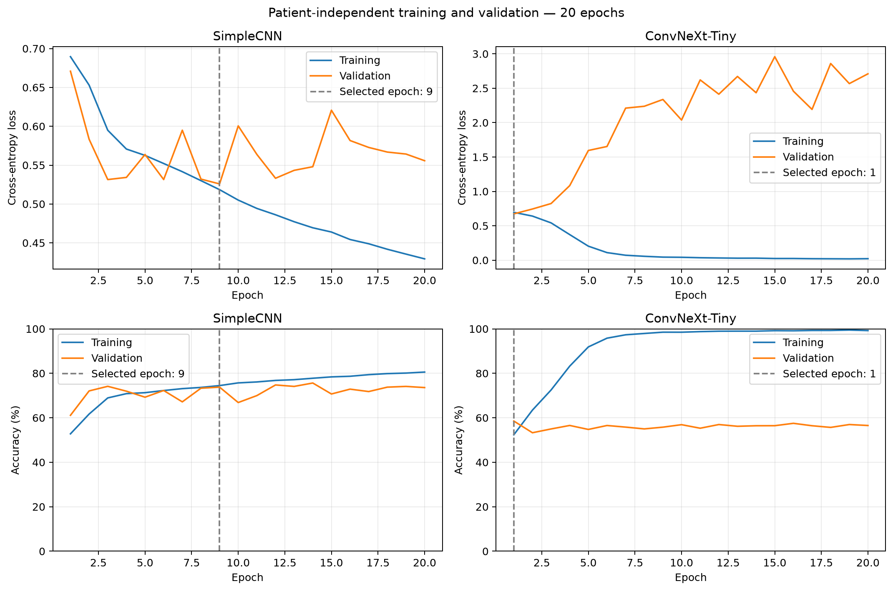

# ADNI Classification with ConvNeXt

## Project status

Updated 24 October 2026. Both the CNN baseline and a single-channel ConvNeXt-Tiny have completed three-epoch pilots and separate twenty-epoch runs on Rangpur. Results below are slice-level validation results reported by the student from cluster logs, not final test results. The existing patient-level split is retained following the leakage audit on 22 October 2026. Check-off completion has not yet been recorded here.

## Objective and model principles

Classify Alzheimer's disease (AD) versus normal control (NC, called CN in the assignment) MRI slices, and investigate whether prediction confidence can identify errors for human review. Compare classification performance, confidence reliability and computational cost.

The baseline uses three convolution/ReLU/pooling blocks, global average pooling and a two-class linear head (23,426 parameters). ConvNeXt-Tiny uses depthwise spatial convolution, LayerNorm, channel expansion/projection, GELU and residual connections. Stage depths are [3, 3, 9, 3] and widths [96, 192, 384, 768]. The implementation adapts the input to one grayscale channel and the output to two classes (27,818,594 parameters). The self-implemented models use no pretrained weights or stochastic depth. Architecture source: [Liu et al., A ConvNet for the 2020s, CVPR 2022](https://arxiv.org/abs/2201.03545) and [author implementation](https://github.com/facebookresearch/ConvNeXt/blob/main/models/convnext.py).

## Data audit and preprocessing

Course data: `/home/groups/comp3710/ADNI/AD_NC`, with `meta_data_with_label.json` in the parent directory. The audit matched all 30,520 images to metadata and identified 680 subjects: 221 AD and 459 NC, with no subjects assigned to both classes in this collection. Original JSON labels AD=2 and NC=0 are mapped to model targets AD=1 and NC=0.

The supplied training/test directories share 216 subjects despite having no common scan IDs. A fixed class-stratified split groups all scans and slices from a subject together, using seed 42:

| Split | Subjects | Scans | Images |
|---|---:|---:|---:|
| Training | 475 | 1,068 | 21,360 |
| Validation | 101 | 229 | 4,580 |
| Test | 104 | 229 | 4,580 |

Subject overlap is zero. Source images are not moved. The loader converts images to grayscale float32 tensors in [0,1], retaining dimensions; sampled inputs were [1,240,256], and both pilot runs completed with batching at this size. The original runs used no augmentation; subsequent experiments apply training-only affine augmentation as described below. Different numbers of scans per subject remain an evaluation/weighting consideration. The test split has not been used for model selection or performance evaluation.

### Leakage audit completed on 22 October 2026

Student-run checks found zero pairwise overlap in patient IDs, scan IDs and paths across the three splits. The combined manifests exactly match the source manifest, with no duplicate paths, conflicting patient classes or scans assigned to multiple patients. All 30,520 images decoded successfully. No duplicate file contents or identical decoded grayscale pixels were found. These checks do not exclude every possible near-duplicate.

Review of the pasted remote code confirmed patient-grouped splitting, per-image preprocessing, validation without parameter updates and checkpoint selection by validation loss. Historical pilot configurations match the current train/validation counts, but do not contain source or manifest hashes. Test-image integrity checks did not involve model-performance evaluation.

## Environment and usage

Reported working environment: Python 3.11.15, PyTorch 2.13.0+cu130, torchvision 0.28.0+cu130, Pillow 12.3.0, NVIDIA A100-PCIE-40GB, compute-node driver 590.48.01. A complete environment export remains to be added. Fixed seeds support repeatability but do not guarantee bitwise reproducibility across hardware/software.

On Rangpur, activate the existing environment:

```bash
source "$HOME/miniconda3/bin/activate"
conda activate torch
cd "$HOME/comp3710_adni_project"
```

For a fresh working directory with these source files, generate local manifests:

```bash
python audit_data.py
python make_splits.py
```

`make_splits.py` refuses to overwrite an existing `splits/` directory. Reuse the established split rather than repeatedly changing it. Paths in generated manifests point to Rangpur data and are not portable to a local machine without those data.

Submit training through Slurm:

```bash
sbatch train_baseline.sh
sbatch train_convnext.sh
squeue --me
```

The scripts run `train.py --epochs 3 --batch-size 8` and `train.py --model convnext --epochs 3 --batch-size 8`, respectively. They currently change to `$HOME/comp3710_adni_project`; adjust that line if running elsewhere. Explicit memory requests were omitted because this partition reports only 1 MB per node to Slurm; this is a site-specific configuration, not physical memory capacity.

Read logs using the actual job ID:

```bash
cat train_baseline_JOBID.out
cat train_baseline_JOBID.err
cat train_convnext_JOBID.out
cat train_convnext_JOBID.err
```

Each run creates `runs/<model>_<timestamp>/config.json`, `training_log.csv` and `best_<model>.pth`. Checkpoints are selected by lowest validation loss. Datasets, manifests, weights and raw runtime outputs are excluded by the project `.gitignore`; generated outputs are not part of the public submission.

## Preliminary results

Both pilots used batch size 8, seed 42 and the same train/validation manifests and preprocessing. The historical baseline config records learning rate 1e-3 but omits optimizer name and weight decay; the current baseline code uses Adam with no weight decay. ConvNeXt: AdamW, learning rate 1e-4, weight decay 0.05. Optimizer differences mean this is not an isolated architecture comparison.

| Model | Epoch | Train accuracy | Validation accuracy | Validation loss |
|---|---:|---:|---:|---:|
| SimpleCNN | 1 | 53.0% | 60.4% | 0.6633 |
| SimpleCNN | 2 | 59.0% | 62.8% | 0.6394 |
| SimpleCNN | 3 | 61.8% | 66.6% | 0.6136 |
| ConvNeXt-Tiny | 1 | 52.3% | 58.4% | 0.6733 |
| ConvNeXt-Tiny | 2 | 63.5% | 53.2% | 0.7440 |
| ConvNeXt-Tiny | 3 | 72.5% | 54.7% | 0.8257 |

Baseline epoch 3 AD/NC recall: 75.2%/57.9%. ConvNeXt best-validation-loss epoch 1 AD/NC recall: 57.6%/59.2%. ConvNeXt's increasing validation loss despite improving training accuracy suggests overfitting or optimization instability; the cause has not been established.

| Model | Train + validation time/epoch | Peak PyTorch-allocated GPU memory |
|---|---:|---:|
| SimpleCNN | 29.3-35.0 s | 124.2 MiB |
| ConvNeXt-Tiny | 132.2-136.8 s | 1,405.7 MiB |

Times exclude startup and checkpoint writing. Allocated tensor memory is not total GPU process usage. Inference latency has not been separately measured. Baseline checkpoint reload and single-image inference passed; Both selected twenty-epoch checkpoints subsequently passed strict model loading and full validation inference, as documented below.

Baseline run: `baseline_20261018_191208_445054`. ConvNeXt pilot run: `convnext_20261019_190724_687263` (job `675518`). The twenty-epoch learning curves are described below.

## Twenty-epoch experiment

Both models were trained from fresh initialization using the retained patient-independent split, batch size 8 and seed 42. The current training configuration uses Adam (learning rate 1e-3, weight decay 0) for SimpleCNN and AdamW (learning rate 1e-4, weight decay 0.05) for ConvNeXt. Checkpoints are selected by minimum validation cross-entropy, not maximum validation accuracy. The results below are from student-supplied cluster logs; selected-epoch validation loss and accuracy were also confirmed by reading the saved training CSV files.

| Model | Selected epoch | Validation loss | Validation accuracy | NC recall | AD recall |
|---|---:|---:|---:|---:|---:|
| SimpleCNN | 9 | 0.525835 | 73.78% | 76.2% | 71.4% |
| ConvNeXt-Tiny | 1 | 0.673260 | 58.54% | 59.3% | 57.8% |

SimpleCNN achieved its lowest validation loss at epoch 9 (0.5258350444315042). Its highest validation accuracy was 75.6% at epoch 14, but the predefined loss-based selection rule was retained. At epoch 20, training accuracy was 80.6% and validation accuracy was 73.6%.

ConvNeXt achieved its lowest validation loss at epoch 1 (0.6732601917987308). By epoch 20, training accuracy reached 99.2%, while validation accuracy was 56.5% and validation loss was 2.7095. The widening training/validation gap is evidence of overfitting under this configuration. This motivated the affine-augmentation experiment reported below; simply extending the same training run is not supported by these results. Optimizer settings differ between models, so the comparison does not isolate architecture as the cause of the performance difference.

| Model | Train + validation time/epoch | Peak PyTorch-allocated GPU memory |
|---|---:|---:|
| SimpleCNN | 27.4-32.9 s | 124.2 MiB |
| ConvNeXt-Tiny | 131.5-138.1 s | 1,405.7 MiB |

Times exclude startup and checkpoint writing. These are slice-level validation results, not final test results; the test split remains reserved for evaluation after model selection.

Run directories:

- `baseline_20261022_211305_056381`
- `convnext_20261022_212324_269607`



The plotting command completed successfully on Rangpur. Copy the generated PNG into the local `figures/` directory and inspect it before committing this report and figure together.

Reproduce the figure in the activated training environment (requires Matplotlib; no GPU required):

```bash
python plot_training_curves.py \
  --baseline runs/baseline_20261022_211305_056381 \
  --convnext runs/convnext_20261022_212324_269607
```

The plot reads saved metrics only; it does not load images or evaluate a model. Dashed lines mark the minimum-validation-loss epoch for each model.

## Feasibility review

The current one-page bilingual review and speaking notes are maintained locally under `D:/codex/作业/COMP3710_Pattern_Recognition/Tutor_Checkoff`. That local path is not a repository artifact. Incorporate the English feasibility review as a clearly identified section of the final README, together with confirmed tutor feedback/check-off status. The audited patient-level split is retained. Teaching-team clarification confirms that the 0.80 test-accuracy target is evaluated at slice level.

## Training-only affine augmentation results

This experiment adds random rotations within +/-5 degrees and translations within 3% of image width/height to training images only, with bilinear interpolation and zero fill. No flips, random crops or scaling are added.

The patient split, model architecture, optimizer settings, batch size 8, seed 42 and 20-epoch budget remain unchanged. Validation preprocessing remains deterministic. Training starts from fresh initialization; checkpoint selection uses minimum validation loss. Test performance is not used to select augmentation settings. Training metrics in this experiment are measured on augmented inputs, unlike the earlier unaugmented training metrics.

New entry points: `dataset_aug.py`, `train_convnext_aug.py` and `train_convnext_aug.sh`. Outputs use separate `runs/convnext_aug_<timestamp>/` directories. Previous scripts and results are retained.

The run `convnext_aug_20261023_161053_071278` completed 20 epochs. Minimum validation loss selected epoch 12: loss 0.6243266117852588, validation accuracy 68.1%, NC recall 68.8% and AD recall 67.4%. These values come from student-supplied cluster logs. The selected checkpoint improves on the unaugmented ConvNeXt run but remains below SimpleCNN. The highest validation accuracy was 69.1% at epoch 18; the loss-based selection rule was retained.

At epoch 20, augmented training accuracy was 88.6%, validation accuracy 65.8% and validation loss 0.8484. Validation loss generally increased after epoch 12 while training loss decreased, indicating continued overfitting. This single-seed result does not establish improvement across seeds. Epoch times were 158.4-163.4 seconds, excluding startup and checkpoint writing; peak PyTorch-allocated GPU memory was 1,405.7 MiB.

```bash
sbatch train_convnext_aug.sh
# Replace JOBID with the returned job number.
squeue -j JOBID
cat train_convnext_aug_JOBID.out
cat train_convnext_aug_JOBID.err
```

## Lower-learning-rate augmentation results

This controlled experiment reduced the ConvNeXt AdamW learning rate from 1e-4 to 3e-5. Affine augmentation, model architecture, weight decay 0.05, batch size 8, seed 42, patient split and the 20-epoch budget remain unchanged. Training starts from fresh initialization. Validation remains unaugmented and checkpoint selection uses minimum validation loss. Test performance is not used for selection.

Entry points: `train_convnext_aug_lr3e5.py` and `train_convnext_aug_lr3e5.sh`, sharing `dataset_aug.py`. The run completed 20 epochs. Outputs use `runs/convnext_aug_lr3e5_<timestamp>/` to preserve previous experiments.

```bash
sbatch train_convnext_aug_lr3e5.sh
# Replace JOBID with the returned job number.
squeue -j JOBID
cat train_convnext_aug_lr3e5_JOBID.out
cat train_convnext_aug_lr3e5_JOBID.err
```

The run `convnext_aug_lr3e5_20261024_043935_000396` selected epoch 6 by minimum validation loss: 0.5767051260723167, with validation accuracy 67.0%, NC recall 62.1% and AD recall 71.8%. Accuracy and recalls are rounded values from student-supplied logs. At epoch 20, training accuracy was 83.7%, validation accuracy 64.8% and validation loss 0.7844. Epoch times were 159.3-163.9 seconds; peak PyTorch-allocated GPU memory was 1,405.7 MiB. Times exclude startup and checkpoint writing.

Compared with augmentation at learning rate 1e-4, the selected validation loss improved while selected-checkpoint accuracy decreased slightly. The predefined loss-based selection rule was retained. Lower cross-entropy alone does not establish good confidence calibration. SimpleCNN still achieved lower validation loss and higher validation accuracy.

### Validation-loss-selected comparison

| Configuration | Selected epoch | Validation loss | Validation accuracy | NC recall | AD recall |
|---|---:|---:|---:|---:|---:|
| SimpleCNN | 9 | 0.525835 | 73.78% | 76.2% | 71.4% |
| ConvNeXt, no augmentation | 1 | 0.673260 | 58.54% | 59.3% | 57.8% |
| ConvNeXt, affine augmentation, LR 1e-4 | 12 | 0.624327 | 68.1% | 68.8% | 67.4% |
| ConvNeXt, affine augmentation, LR 3e-5 | 6 | 0.576705 | 67.0% | 62.1% | 71.8% |

These are validation results used during development, not final test estimates. The checkpoints evaluated below are the SimpleCNN epoch-9 and augmented LR-3e-5 ConvNeXt epoch-6 checkpoints. No test performance was used for selection.

### Checkpoint file verification (24 October 2026)

The student successfully read both selected checkpoint files on CPU using `torch.load(..., map_location="cpu", weights_only=True)`:

| Run | Saved model | Saved epoch | Saved validation loss | Learning rate | State-dictionary entries |
|---|---|---:|---:|---:|---:|
| `baseline_20261022_211305_056381` | SimpleCNN | 9 | 0.5258350444315042 | 0.001 | 8 |
| `convnext_aug_lr3e5_20261024_043935_000396` | ConvNeXtTiny | 6 | 0.5767051260723167 | 0.00003 | 182 |

Both record `validation_loss` as the selection metric. This initial check verified file deserialization and agreement with the training logs. Subsequent strict model loading, forward inference and aggregate validation-loss reproduction succeeded, as reported below.

## Validation evaluation

`predict.py` strictly loads a saved checkpoint and evaluates only the fixed validation manifest without augmentation or parameter updates. It reports cross-entropy, accuracy, balanced accuracy, per-class precision/recall/F1, macro-F1, AD-positive AUROC and a confusion matrix (rows: true; columns: predicted; order: NC, AD). Predictions use logit argmax. Undefined precision is reported as zero; AUROC requires both classes and groups tied scores.

`evaluate_validation.sh` evaluates the selected SimpleCNN and ConvNeXt checkpoints. Aggregate results are saved in each run's `validation_metrics.json`, including the validation-manifest hash and difference from the recorded checkpoint loss. Existing results are not overwritten. No patient identifiers or image paths are included in this JSON. Probabilities are not yet calibrated. Both evaluations completed successfully; this version does not implement final test evaluation or patient-level aggregation.

```bash
sbatch evaluate_validation.sh
# Replace JOBID with the returned job number.
squeue -j JOBID
cat validation_JOBID.out
cat validation_JOBID.err
```

The `validation_*.out` and `validation_*.err` files are local job logs; do not select them for Git commits.

### Reproduced validation results (24 October 2026)

Student-supplied evaluation outputs confirm successful strict checkpoint loading and inference on the same 4,580 validation slices from 101 patients. Both models exactly reproduced the loss recorded in their checkpoints (`loss_difference = 0.0`). Both reported the audited validation manifest SHA-256: `e1217d294d7d0c93749e7661b1dff3d929488a65ad1ab8aecbad19498e16945a`. Evaluation used CUDA, batch size 8 and PyTorch 2.13.0+cu130.

| Metric | SimpleCNN, epoch 9 | ConvNeXt + augmentation, LR 3e-5, epoch 6 |
|---|---:|---:|
| Cross-entropy | 0.525835 | 0.576705 |
| Accuracy | 73.78% | 67.01% |
| Balanced accuracy | 73.79% | 66.99% |
| Macro-F1 | 0.7377 | 0.6692 |
| AD-positive AUROC | 0.8157 | 0.7520 |
| NC precision | 72.53% | 68.62% |
| NC recall | 76.18% | 62.15% |
| NC F1 | 0.7431 | 0.6522 |
| AD precision | 75.15% | 65.69% |
| AD recall | 71.39% | 71.83% |
| AD F1 | 0.7322 | 0.6862 |

Class supports are 2,280 NC and 2,300 AD slices. Confusion matrices use true classes as rows and predicted classes as columns:

| Model | True NC, predicted NC | True NC, predicted AD | True AD, predicted NC | True AD, predicted AD |
|---|---:|---:|---:|---:|
| SimpleCNN | 1,737 | 543 | 658 | 1,642 |
| ConvNeXt | 1,417 | 863 | 648 | 1,652 |

At the default argmax rule, ConvNeXt correctly classified 10 more AD slices but misclassified 320 more NC slices as AD than SimpleCNN. SimpleCNN achieved higher overall accuracy, macro-F1 and AUROC. AUROC 0.8157 is not 81.57% classification accuracy and does not establish the assignment's test-accuracy target.

These are slice-level validation results used during development, not independent final test estimates or patient-level metrics. Confidence probabilities remain uncalibrated. Next steps are slice-level validation prediction export and confidence/referral analysis before final test evaluation. Patient aggregation is optional and deferred.

## Deferred optional patient aggregation

This optional workflow is deferred following teaching-team clarification; the slice-only workflow below is the current priority. The previously proposed `export_validation.py` workflow exports validation logits and probabilities for confidence analysis. Patient predictions average slice probabilities within each scan, then average scan probabilities within each patient. This aggregation rule is fixed before inspecting patient-level results. Predictions use argmax, with exact ties assigned to NC.

Private `slice_predictions.csv` and `patient_predictions.csv` files remain under each run's `validation_export/` directory and must not be committed because they contain patient and scan identifiers. `summary.json` contains aggregate metrics only.

The export also recomputes slice-level metrics to check consistency with the earlier evaluation. Probabilities remain uncalibrated. Implementation execution and patient-level results have not yet been confirmed. This workflow does not retrain models or evaluate the test split.

Once the export scripts are available in the remote project directory, submit and inspect the job using:

```bash
sbatch export_validation.sh
# Replace JOBID with the returned job number.
cat validation_export_JOBID.out
cat validation_export_JOBID.err
```

## Teaching-team clarifications and current evaluation plan

According to teaching-team Q&A supplied by the student, the 0.80 test-accuracy target applies to individual slices. Patient aggregation is optional and cannot replace the required slice-level metric. Patient-independent splitting remains necessary to prevent leakage.

The model architecture must be defined by the student; directly calling a prebuilt ConvNeXt does not meet that requirement. The self-implemented ConvNeXt remains the primary architecture. Public implementations may be referenced and adapted with proper attribution, but experiments and analysis must be the student's own work. Training from scratch is the default; pretrained weights require explicit justification, acknowledgement and supporting comparison.

The teaching team states that a shortfall against the 0.80 target will not itself lose marks when supported by reasonable trial experiments, best effort and sound analysis. This does not remove other assessment requirements. Dataset preprocessing may provisionally be treated as consistent between the original partitions, but the exact 20-slice selection procedure has not been confirmed.

### Slice-level prediction export

`export_slice_predictions.py` exports validation logits, probabilities, predictions and correctness for the self-implemented models. `row_index` is the zero-based data-row index in the validation manifest and can support later failure-case lookup. Outputs contain no patient IDs or image paths, but remain private runtime artifacts under each run's `validation_slice_export/` directory. Existing export directories are not overwritten.

The script recomputes slice-level metrics for consistency checking. It does not train a model, aggregate patients, calibrate probabilities or load test images. Export execution is pending.

```bash
sbatch export_slice_predictions.sh
# Replace JOBID with the returned job number.
cat validation_slices_JOBID.out
cat validation_slices_JOBID.err
```

Do not commit generated predictions or `validation_slices_*.out/.err` logs. Use the exported validation predictions for confidence and referral analysis; final test evaluation remains held out.

## Local Windows execution

Local hardware reported on 25 October 2026: NVIDIA RTX 4050 Laptop GPU, 6,141 MiB total VRAM, driver 596.21. The repository `.venv` uses Python 3.14.7 and did not yet have PyTorch installed when inspected. Local GPU training feasibility and speed remain to be measured; A100 measurements do not establish laptop timings or memory usage.

`prepare_local_data.py` verifies the original split hashes and every local image path, then writes separate `local_data/splits_local/` manifests without changing patient membership. Original manifests remain unchanged. The repository already ignores `/local_data/`. This path audit does not verify downloaded image contents.

`train_convnext_local.py` preserves the self-implemented ConvNeXt, affine augmentation, AdamW LR 3e-5 and weight decay 0.05. It reads local manifests and uses zero DataLoader workers for Windows. `--smoke` processes only two training and two validation batches, saves no checkpoint, and labels its outputs diagnostic-only. Results go into ignored project `runs/` directories. Full training defaults should be passed explicitly; no stochastic-depth or mixed-precision changes are introduced during the environment migration.

From the project folder in PowerShell, use the repository virtual-environment Python:

```powershell
$py = "D:\Github\PatternAnalysis-2026\.venv\Scripts\python.exe"
& $py prepare_local_data.py
& $py -u train_convnext_local.py --model convnext --batch-size 8 --smoke 2>&1 | Tee-Object -FilePath local_smoke.log
cat local_smoke.log
```

Do not commit `local_smoke.log`. If the local check passes, use measured memory and speed to decide full-run settings. Keeping batch size 8 preserves the earlier optimization setup; lowering it changes the experiment and must be recorded. Local package versions and hardware differ from Rangpur, so exact numerical reproduction is not guaranteed.

## Remaining work

- Confirm recorded check-off completion; retain the audited patient split and use slice-level test accuracy.
- Prioritize slice-level confidence analysis for the self-implemented models; defer patient aggregation. The unused prebuilt-model experiment scripts have been removed.
- Extend the validated inference pipeline with private per-sample prediction export, final evaluation and visualizations.
- Perform held-out slice-level evaluation after model and operating-rule selection; patient aggregation is optional.
- Analyse calibration/referral thresholds, profile inference latency and examine 3-5 real failures with figures.
- Inspect and include the generated training plot; add feasibility-review content, complete environment details and final engineering recommendation.
- Export the completed README to PDF for Turnitin; submit a working upstream PR and respond to later code review.

## Artificial Intelligence Usage Disclosure

ChatGPT/Codex assisted with project planning, explanation of concepts, drafting and revising audit/split/data-loader/model/training/check scripts, Slurm troubleshooting, interpretation of supplied outputs, learning-curve plotting, and feasibility-review/README drafting. The ConvNeXt architecture was referenced from the paper and author implementation linked above.

The student ran the data and split audits, CPU model checks, GPU training smoke tests, a fixed-batch learning check, both three-epoch train/validation pilots, both original twenty-epoch runs, the twenty-epoch affine-augmentation run, the lower-learning-rate augmentation run, baseline checkpoint inference and CPU deserialization of both selected checkpoint files and full validation inference with exact loss reproduction on Rangpur. These checks provide the reported evidence; they do not validate all implementation details, clinical use, calibration or final test performance. Further code understanding, review and empirical validation remain part of the student's responsibility. Update this disclosure as work progresses.

